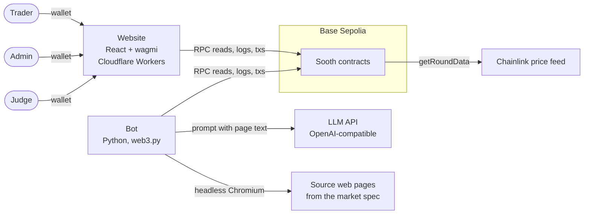
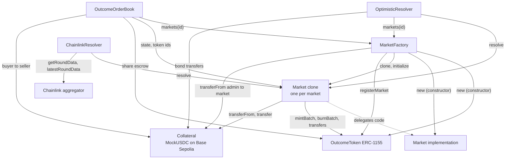
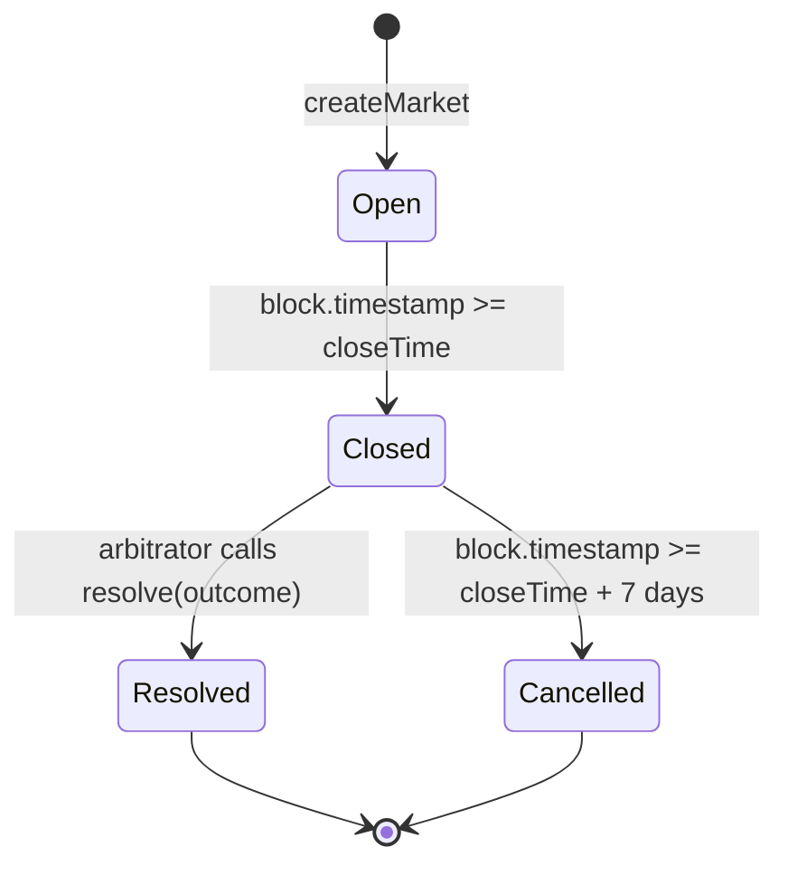
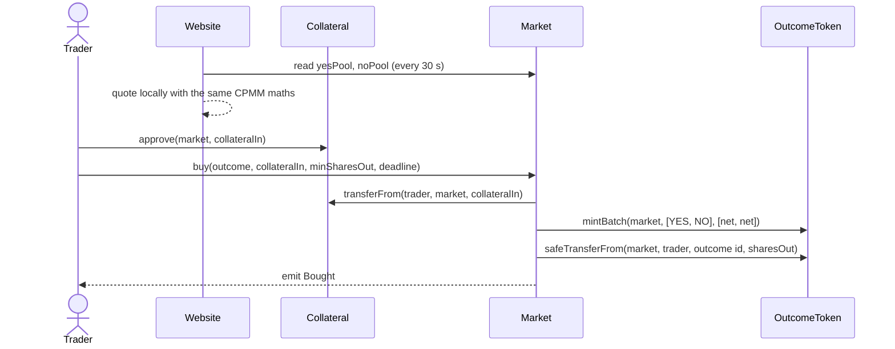
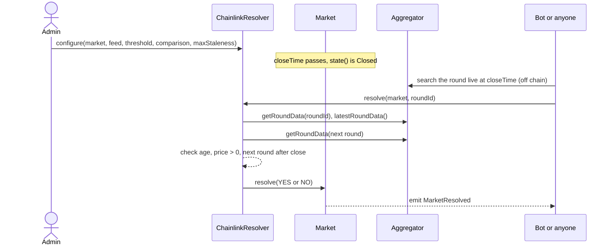
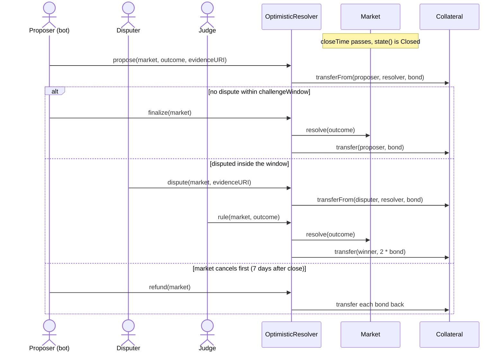
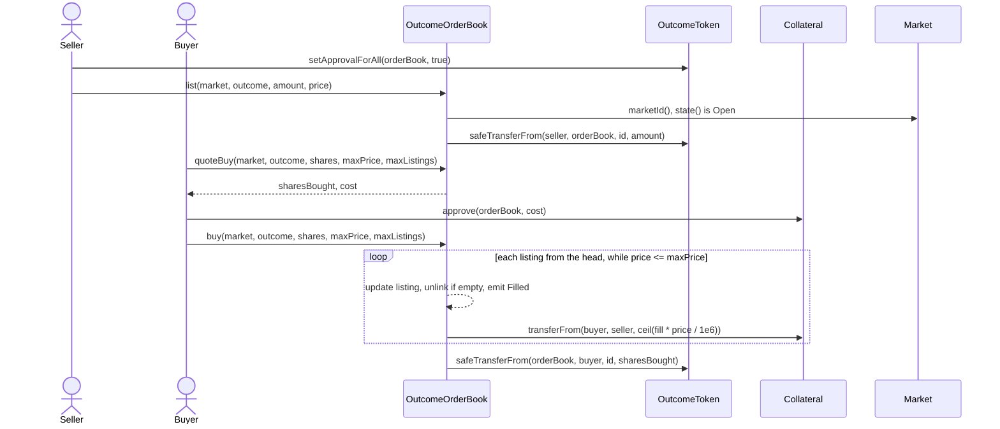
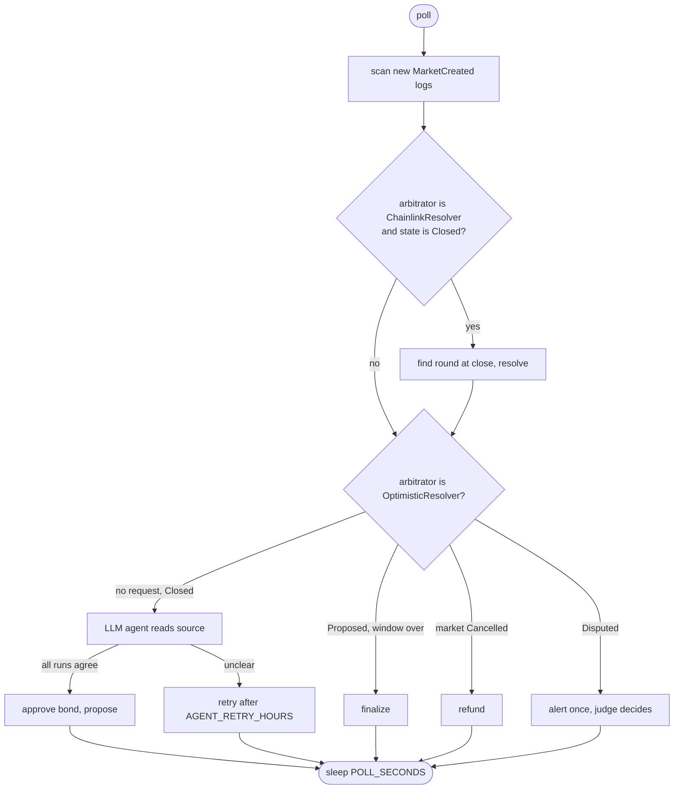
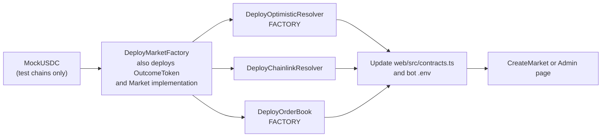

# Architecture

This is the system overview of Sooth: what runs on chain, what runs off chain, and how the parts talk.
Function-level rules are in [contract-spec.md](contract-spec.md). Each section links the component doc.

## 1. System context

Sooth is a binary (YES/NO) prediction market on Base Sepolia (chain id 84532). Users trade through a
website. Markets settle through one of three arbitrators. An optional bot automates resolution.

| Actor | What they do |
|---|---|
| Trader | Buys and sells YES/NO shares, lists and buys on the order book, redeems after settlement |
| Admin | Holds `DEFAULT_ADMIN_ROLE` on the factory. Creates markets, configures price markets, triggers creator withdrawals |
| Judge | Owner of `OptimisticResolver`. Rules on disputed proposals |
| Proposer / disputer | Anyone who posts a bond on `OptimisticResolver`. The bot is one proposer |
| Bot | Resolves Chainlink markets, proposes and finalizes optimistic markets, alerts on disputes |

## 2. On-chain vs off-chain

| Concern | On chain | Off chain |
|---|---|---|
| Collateral, shares, prices, fees | `Market`, `OutcomeToken`. All money stays in contracts | Website shows them |
| Market list | `MarketFactory.marketCount`, `markets(id)` | Website and bot read these and scan `MarketCreated` |
| Market question and rules | Only `specHash` is stored. The full spec JSON is in the `MarketCreated` log | Website parses the spec JSON. The bot reads its source URL |
| Price-market outcome | `ChainlinkResolver` reads the feed and decides | Bot or website finds the round id at close and calls `resolve` |
| Non-price outcome | `OptimisticResolver` holds bonds and enforces windows | Bot's LLM agent reads the source page and proposes. Evidence is a URI in the `Proposed` log |
| Disputes | `OptimisticResolver.rule` by the judge | Judge decides off chain. The bot only alerts |
| Trade history, charts | Events only (`Bought`, `Sold`, ...) | Website rebuilds history from logs in the browser |
| Order book | `OutcomeOrderBook` holds listings and escrow | Website reads the book with view calls |
| Hosting | none | Cloudflare Workers serves the built site. The bot runs wherever someone starts it |

Nothing off chain can move funds or change an outcome on its own: the bot and website only send
transactions that the contracts check. The trust points are the admin, the judge, the Chainlink feed and
any custom arbitrator ([threat-model.md](threat-model.md)).

## 3. Contracts and call graph

| Contract | Role | Spec |
|---|---|---|
| `MarketFactory` | Creates markets. Deploys `OutcomeToken` and the `Market` implementation in its constructor | [§1](contract-spec.md#1-marketfactory) |
| `Market` | One EIP-1167 clone per market: AMM, resolution entry point, payouts | [§2](contract-spec.md#2-market) |
| `OutcomeToken` | One ERC-1155 for all markets. Token id = `keccak256(abi.encode(marketId, outcome))` | [§3](contract-spec.md#3-outcometoken) |
| `OptimisticResolver` | Arbitrator: bonded proposal, dispute, judge | [§4](contract-spec.md#4-optimisticresolver) |
| `ChainlinkResolver` | Arbitrator: price at close from a Chainlink feed | [§5](contract-spec.md#5-chainlinkresolver) |
| `OutcomeOrderBook` | Fixed-price listings of shares (Bonus 1) | [§6](contract-spec.md#6-outcomeorderbook) |

- Only the factory can initialize a clone and register token ids. Only a market can mint or burn its own ids.
- A market's `arbitrator` is fixed at creation; only that address can call `Market.resolve`.
- `OptimisticResolver` and the order book only accept markets the factory lists
  (`factory.markets(market.marketId()) == market`). `ChainlinkResolver` relies on its owner configuring
  only real markets.

Creation and the clone pattern: [market-creation-explained.md](market-creation-explained.md).

## 4. Market state machine

`Closed` and `Cancelled` are never written: `Market.state()` derives them from the clock while the stored
state is `Open`. Only `resolve` writes a new state (`Resolved`). The enum value `Proposed` is never used by
`Market`.

What each state allows: [contract-spec.md §10](contract-spec.md#10-what-works-in-which-market-state).
Payouts: [market-settlement.md](market-settlement.md).

## 5. Trading on the AMM

Each market is a constant-product pool of YES and NO shares. A buy mints a YES+NO pair per net collateral
unit and swaps through the pool; the 1% fee goes to `accruedFees`. Pricing and rounding:
[trading-engine.md](trading-engine.md).

A sell is the reverse (after `setApprovalForAll`). The website quotes in the browser (`web/src/mock.ts`)
from the pools it last read, not by calling `Market.quoteBuy`; `minSharesOut` / `minCollateralOut`
protects the trader if the pools moved.

## 6. Resolution flows

A market is resolved by its `arbitrator`. If nobody resolves it within 7 days of close, it cancels by
itself and every share pays half a unit.

### 6.1 Chainlink (price markets)

The admin configures the feed before close (`CreateMarket.s.sol`, or the Admin page right after
creation). After close, anyone resolves with the round that was live at `closeTime`; the contract checks
the round, so the caller cannot pick the price. Details: [chainlink-resolver.md](chainlink-resolver.md).

### 6.2 Optimistic (all other markets)

Anyone can call `finalize` and `refund`, not only the proposer. Deployed parameters: bond 10 mUSDC,
challenge window 2 hours. Details: [optimistic-resolver.md](optimistic-resolver.md).

### 6.3 Custom arbitrator

The admin can name any address as arbitrator ("custom" on the Admin page). That address calls
`Market.resolve(outcome)` directly while the market is `Closed`, and is fully trusted.

## 7. Order book flow

One `OutcomeOrderBook` serves every market of the factory. Listings are kept per (market, outcome),
cheapest first, oldest first at the same price. `list` and `buy` work only while the market is `Open`;
`cancel` works in every state. The website panel shows while `ORDER_BOOK` in `web/src/contracts.ts` is set
(the zero address hides it). Details: [order-book.md](order-book.md).

## 8. Settlement and payouts

After `Resolved` or `Cancelled`, `redeem()` burns the caller's YES and NO and pays them;
`withdrawLiquidity()` pays the creator the value of the pool's own shares, once; `withdrawFees()` pays the
accrued fees (from `Closed` on). Anyone may trigger the withdrawals; the money always goes to `creator`.
The website's Collect page sweeps all markets in one Multicall3 `aggregate3` transaction with
`allowFailure` on each call.

## 9. Website (`web/`)

React + TypeScript + Vite, with wagmi, viem and RainbowKit. Config: `web/src/wagmi.ts`. Addresses and ABIs:
`web/src/contracts.ts`.

| Route | Page | Contract calls |
|---|---|---|
| `/` | `Home.tsx`: market list | Reads only (via `chain.ts`) |
| `/market/:id` | `Market.tsx`: trade, resolution card, order book panel, claims | `Market.buy` / `sell` / `redeem` / `withdrawLiquidity`; resolver actions in `resolution.tsx`; order book in `orderbook.tsx` |
| `/portfolio`, `/portfolio/:address` | `Portfolio.tsx`: positions and history | `Market.redeem` for settled positions; otherwise reads |
| `/admin/create` | `Admin.tsx`: create market | Collateral `approve`, `createMarket`, then `ChainlinkResolver.configure` for price markets |
| `/admin/collect` | `Collect.tsx`: creator withdrawals | Multicall3 `aggregate3` of `withdrawFees` / `withdrawLiquidity` |

How it reads the chain (`web/src/chain.ts`):

1. Pins every read to one block number, so state and logs match.
2. Reads `marketCount`, each `markets(id)`, and each market's pools, `closeTime`, `state`,
   `winningOutcome` and `liquidityWithdrawn`.
3. Scans logs with `getLogs` from `DEPLOY_BLOCK` (`50_040_022`) for the factory, both resolvers, every
   market and (once `ORDER_BOOK` is set) the order book, up to 10,000,000 blocks per call
   (`MAX_LOG_RANGE`). Later refreshes scan only new blocks.
4. Refetches every 30 seconds. Positions come from `OutcomeToken.balanceOfBatch`.

The RPC is a public Tenderly gateway for Base Sepolia (it allows large `getLogs` ranges), with viem's
default RPC as fallback. There is no indexer and no backend; the code marks this as a shortcut (an indexer
such as Ponder is the planned fix). The live order book is read with view calls (`bestPrice`,
`listingsOf`, `getListing`, `quoteBuy`); its `Filled`, `Listed` and `Cancelled` logs feed trade history
and positions ([order-book.md](order-book.md#website)). The AMM price chart and volume use pool trades only.

Wallets: browser extension wallets (EIP-6963 discovery on). With `VITE_WALLETCONNECT_PROJECT_ID` set, the
list is MetaMask, Trust, Rabby, Phantom and WalletConnect.

## 10. Bot (`bot/`)

A Python worker (`uv run python -m sooth_bot`). It is stateless: each poll re-reads the chain, so restarts
and duplicate attempts are safe. It loads ABIs from `contracts/out`, so `forge build` must run first.
Details: `bot/README.md`.

| Module | Job |
|---|---|
| `__main__.py` | Poll loop (default every 300 s). Survives RPC errors |
| `config.py` | Reads env vars: `RPC_URL`, `FACTORY`, `DEPLOY_BLOCK`, both resolver addresses, `BOT_PRIVATE_KEY`, `LLM_API_KEY`, and optional tuning |
| `chain.py` | web3 connection. Finds markets by scanning `MarketCreated` in 50,000-block chunks. Sends transactions |
| `chainlink.py` | For `Closed` markets whose arbitrator is `ChainlinkResolver`: binary-searches the round at close and calls `resolve` |
| `optimistic.py` | For markets whose arbitrator is `OptimisticResolver`: `propose` after close (approves exactly one bond), `finalize` after an undisputed window, `refund` on cancelled markets, one alert per dispute (log and optional webhook) |
| `agent.py` | Opens the spec's source URL in headless Chromium and asks an OpenAI-compatible LLM. Proposes only if the page stayed on the source site, every quote is on the page, and all `AGENT_RUNS` runs agree |

The bot must use its own wallet, never the admin or judge key, so the judge never rules on their own
proposal.

## 11. Deployment

### Base Sepolia (chain 84532)

| Contract | Address | Source |
|---|---|---|
| `MarketFactory` | `0x8d399B14ea106bA62F79186217DB6fF1F75dc492` | `broadcast/DeployMarketFactory.s.sol/84532/run-latest.json`, block 50040022 |
| `OutcomeToken` | `0xA2D1e9A1e195d01B1aC21090962B7F2AD76BDB5B` | Same file (created by the factory constructor) |
| `Market` implementation | `0x3a69D08ba7Ab7CcE6f8f53Fc193bAD9Ac661D098` | Same file (created by the factory constructor) |
| `OptimisticResolver` | `0xe37DB6692De70F5fe69fcABb64b7C737fA096335` | `broadcast/DeployOptimisticResolver.s.sol/84532/run-latest.json`, block 50040832 |
| `ChainlinkResolver` | `0xAD3F05e6eFFeCD81278894266f5816691E704638` | `broadcast/DeployChainlinkResolver.s.sol/84532/run-latest.json`, block 50040516 |
| `MockUSDC` (collateral) | `0x5f29331BBBA6f605942f5de0B217359F3C7B7c51` | `COLLATERAL` argument of the factory deploy; `web/src/contracts.ts` |
| `OutcomeOrderBook` | `0x539a5842371cEeA853A5Adab48bAFc2a5d9B2b05` | `broadcast/DeployOrderBook.s.sol/84532/run-latest.json`, block 55252775 |

Market clones are created by `createMarket`; their addresses come from `factory.markets(id)`.

### Deploy order

After a new deploy, copy the addresses by hand into `web/src/contracts.ts` (including `DEPLOY_BLOCK`)
and the bot's `.env`. Nothing reads the broadcast files automatically.

### Website hosting

`wrangler.jsonc` at the repo root configures a Cloudflare Worker named `sooth` that serves `web/dist` as a
single-page app (`not_found_handling: single-page-application`). Build with `npm run build` in `web/`. No
CI job deploys the site; how deploys are triggered is not recorded in the repo. TODO: evidence.

### CI (`.github/workflows/ci.yml`)

Runs on pushes and pull requests to `main`, and by hand.

| Job | Steps |
|---|---|
| Contracts | `forge fmt --check`, `forge build --sizes`, `forge test -vvv` (Foundry pinned to v1.8.5) |
| Bot | `uv sync --locked`, install Chromium, `uv run pytest`. Fails if the browser tests were skipped |

The website has no CI job.
