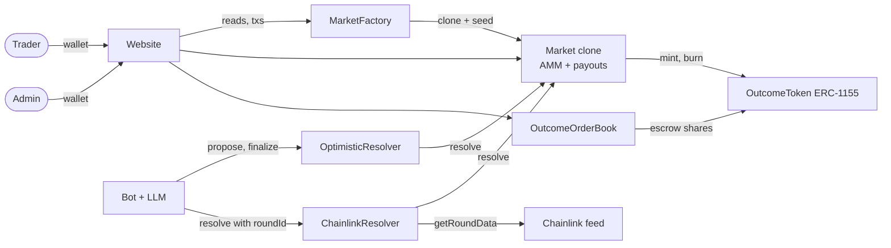

# Final report

Sooth is a binary (YES/NO) prediction market dApp on Base Sepolia. This report explains the problem we
solved, how the design solves it and why we made each design choice.

How we used AI and what it got wrong is in the [AI Audit Report](ai-audit-report.md) and the per-member
[AI logs](ai/). This report does not repeat them.

## 1. Problem identification

The course brief asks for a decentralized market where users create, trade and resolve markets on future
real-world events. We read it as three problems.

| Problem | What goes wrong today | What a smart contract can do | What it cannot do |
|---|---|---|---|
| **Incentive alignment** | Forecasters are not paid for being right, so forecasts are cheap talk | Let people buy YES/NO shares. A share pays 1 if right, 0 if wrong, so the price is the crowd's probability | Make the crowd well-informed |
| **Custody and settlement** | A sportsbook holds the money, takes a rake and can limit or close accounts | Hold the collateral in a contract. Pay winners by rule, with no operator able to block a payout | Stop an admin from creating a bad market |
| **The oracle problem** | A contract cannot see the real world, so someone must report the outcome | Make reporting accountable: a fixed arbitrator per market, bonds, a challenge window, a price feed, and a fallback when nobody reports | Know the truth |

**Trust statement.** The chain guarantees settlement, not truth. Once an outcome reaches
`Market.resolve`, winners get exactly 1 collateral unit per share, once. Whether that outcome is true
depends on the market's arbitrator: the Chainlink feed, the optimistic proposer plus disputers plus the
judge, or a custom address. Bonds and disputes reduce the oracle problem; they do not remove it. Actors
and trust: [threat-model.md §2-3](threat-model.md).

## 2. Solution overview

Lifecycle of one market:

1. **Create.** The admin calls `MarketFactory.createMarket`; the factory clones `Market` and seeds a 50/50 pool.
2. **Trade.** While `Open`, anyone trades YES/NO on the AMM or on the order book (Bonus 1).
3. **Close.** At `closeTime` trading stops. `Closed` is derived from the clock, not written.
4. **Resolve.** Within 7 days (`RESOLUTION_WINDOW`), the arbitrator calls `Market.resolve(outcome)`.
5. **Pay out.** Holders call `redeem()`. If nobody resolved in time, the market is `Cancelled` and every
   share redeems at half a unit.

Diagrams: [architecture.md](architecture.md).

## 3. Feature requirements: what we built and where

Each row is a bullet of "Feature Requirements" in the course brief. Test names are from
`contracts/test/` and are described in [testing.md](testing.md).

| Requirement | How Sooth meets it | Code | Tests |
|---|---|---|---|
| **Market creation:** topics with outcome options | A question, rules and source go into a spec JSON. Its `keccak256` is stored as `specHash`; the full spec is in the `MarketCreated` log. Outcomes are fixed to YES and NO (`IMarket.Outcome`) | `MarketFactory.createMarket`, `_validate`; `web/src/pages/Admin.tsx` | `test_CreateMarket_StoresParameters`, `test_CreateMarket_EmitsMarketCreated`, `test_RevertWhen_SpecEmpty` |
| **Market creation:** timestamps | `closeTime` must be in the future. `resolutionDeadline() = closeTime + 7 days`. State is derived from the clock | `MarketFactory._validate`, `Market.state` | `test_RevertWhen_CloseTimeInPast`, `test_RevertWhen_CloseTimeIsNow`, `test_StateMovesFromOpenToClosedToCancelledWithoutTransactions` |
| **Market creation:** arbitrator identities | `arbitrator` is fixed per market and must be non-zero. It can be `OptimisticResolver`, `ChainlinkResolver` or any address ("custom" on the Admin page) | `Market.arbitrator`, `Market.resolve`; `Admin.tsx` resolution picker | `test_RevertWhen_ArbitratorIsZero`, `test_CreateMarket_ArbitratorCanBeCreator`, `test_RevertWhen_ResolverIsNotArbitrator` |
| **Trading and minting:** place bets, receive outcome tokens | `buy` takes collateral, mints a YES+NO pair per net unit and sends the chosen side from the pool. `sell` is the reverse. Slippage (`minSharesOut`, `minCollateralOut`) and `deadline` on both | `Market.buy`, `Market.sell`, `OutcomeToken.mintBatch` / `burnBatch`; `web/src/components.tsx` trade panel | `test_BuyQuoteMatchesExecutionAndAccountsForFee`, `test_SellQuoteMatchesExecutionAndBurnsFromMarketCustody`, `test_RevertWhen_BuyBelowMinShares`, `test_RevertWhen_TradingAfterClose`, `testFuzz_BuyThenSellCannotProfit` |
| **Trading and minting:** dynamically derive odds | Constant-product pool. `priceYes = noPool / (yesPool + noPool)` (18 decimals), `priceNo` the mirror. Every trade moves it | `Market.priceYes`, `priceNo`, `_quoteBuy`, `_quoteSell` | `test_BuyNoMovesPriceInOppositeDirection`, `test_SellNoMovesPriceInOppositeDirection`, `test_CreateMarket_StartsAtFiftyFifty`, `invariant_COL_6_productNeverFallsAndRoundTripNeverProfits` |
| **Resolution and payouts:** arbitrator submits final outcome | Only `arbitrator`, only while `Closed`, only once. Three arbitrator types (section 4.5) | `Market.resolve`, `OptimisticResolver`, `ChainlinkResolver`; `web/src/resolution.tsx`; `bot/` | `test_ArbitratorResolvesClosedMarket`, `test_RevertWhen_ResolvingTwice`, `test_FinalizeResolvesMarketAndReturnsBond`, `test_RuleForDisputerPaysDisputerBothBonds`, `test_E2E1_DirectYes` to `test_E2E8b_...`, `invariant_RES_1_resolvedAtMostOnce` |
| **Resolution and payouts:** winners redeem | `redeem` burns all the caller's YES and NO and pays 1 per winning share (Resolved) or half per share (Cancelled) | `Market.redeem`, `_settlementValue`; Market and Portfolio pages | `test_WinnerRedeemsOneCollateralPerShare`, `test_RevertWhen_RedeemingTwice`, `test_CancelledRedeemPaysHalfPerShare`, `invariant_RED_2_redeemPaysOnePerWinningShare`, `invariant_RED_4_noDoubleClaims` |
| Cancel and refund path (team rule: never cut) | No outcome by the deadline: market cancels by itself; shares pay half; bonds are refunded | `Market.state`, `_settlementValue`, `OptimisticResolver.refund` | `test_E2E7_TimeoutCancelsAndRefunds`, `test_E2E8_OptimisticDisputedLeftOpenRefundsBothBonds`, `invariant_RED_3_cancelledRedeemPaysHalf`, `invariant_BND_4_refundMakesEveryoneWhole` |
| **Bonus 1:** secondary market before resolution | **Built.** `OutcomeOrderBook`: holders list shares at a fixed price, buyers fill cheapest first. **Deployed on Base Sepolia** (`0x539a5842371cEeA853A5Adab48bAFc2a5d9B2b05`) | `OutcomeOrderBook.sol`; `web/src/orderbook.tsx` (hidden while `ORDER_BOOK` is the zero address) | 38 tests in `OutcomeOrderBook.t.sol` (e.g. `test_Buy_FillsCheapestFirst`, `test_RevertWhen_ReenteringBuyFromReceiver`, `test_EndToEnd_AmmBookResolveRedeem`); `invariant_OB_1_escrowEqualsOpenListings` to `invariant_OB_4_...` |
| **Bonus 2:** multi-asset collateral | **Not built** (decided 2026-11-04 to fit the deadline). One 6-decimal collateral per factory | `MarketFactory` constructor (`InvalidCollateralDecimals`) | `test_RevertWhen_CollateralDecimalsNotSix` |
| **Bonus 3:** reputation-weighted voting | **Not built** (same decision). Disputes go to one judge | – | – |

Live demo evidence for these rows: TODO: evidence (live demo).

## 4. Design justifications

### 4.1 Chain and toolchain

| Choice | Why | Cost |
|---|---|---|
| Solidity on an EVM chain | Standard tools (OpenZeppelin, Foundry, wagmi/viem, Chainlink) and the course content | Gas costs and public mempool (front-running) |
| **Base Sepolia** (chain id 84532) | About 2 s blocks for a fast demo, very cheap gas, BaseScan verification, plain EVM behaviour. A prediction market has many small trades, so L2 fees matter | Test ETH sometimes has to be bridged. No L2 sequencer uptime feed (K-3) |
| Foundry (forge 1.8.5, solc 0.8.28) | Fast tests, fuzz and stateful invariant testing in Solidity | – |
| Time, not block numbers | All windows use `block.timestamp`, so the design does not depend on block time | Validator drift of seconds (Slither `timestamp` results, justified in [testing.md](testing.md#security-analysis)) |

Base Sepolia was chosen in practice (the website and MockUSDC already used it), not by a formal team
vote. TODO(team): confirm the chain decision was agreed.

### 4.2 Market structure: factory, clones, one ERC-1155

- **One clone per market (EIP-1167).** Each market's collateral sits in its own contract, so a bad market
  cannot drain others, and a clone (about 45 bytes) is much cheaper than a full deploy. Only the factory can
  initialise a clone, and the implementation cannot be initialised
  (`test_RevertWhen_NonFactoryInitializesClone`, `test_RevertWhen_ImplementationInitialized`).
- **One `OutcomeToken` (ERC-1155) for all markets.** Wallets and the website track one contract. Only the
  market that owns a token id can mint or burn it.
- **Admin-only creation.** `createMarket` needs `DEFAULT_ADMIN_ROLE`, and the admin supplies the seed. The
  admin picks the arbitrator, which is a trust point (R-4); open creation would need creator bonds (not built).
- **Seed check uses `>=`.** Clone addresses are predictable; an exact balance check would let anyone block
  creation by sending 1 unit first (C-13).

Details: [market-creation-explained.md](market-creation-explained.md).

### 4.3 Collateral model

- **Complete sets.** 1 YES + 1 NO is always backed by exactly 1 unit of collateral. A buy mints pairs; a
  sell or redeem burns them. So the market can always pay: Resolved pays 1 per winning share, Cancelled
  pays `(yes + no) / 2` rounded down. Checked by `invariant_COL_2_...` and
  `invariant_RED_1_payoutsNeverExceedReceipts`.
- **6-decimal collateral only.** On testnet it is `MockUSDC` (anyone can mint it).
- **Fees apart from backing.** The 1% fee (`FEE_BPS = 100`, rounded up) goes to `accruedFees`, owed to the
  market's `creator`. It is never used to mint shares.
- **Recorded pools, not balances.** `yesPool` and `noPool` are stored values, so donations cannot move
  prices (`test_DonationsDoNotChangeRecordedReserves`). Donated tokens stay in the market (K-6).
- **Cancel pays 50/50.** With no result there is no fair winner. Half per share returns the collateral of
  every complete set and never needs more than the market holds.

### 4.4 Pricing: constant-product AMM

The team chose a constant-product AMM at the start. The comparison below sets out why it fits this project.

| Option | For | Against |
|---|---|---|
| **Constant product (chosen)** | Always a price and a counterparty, even with few traders. Integer maths only (no `exp`/`ln`). Familiar from Uniswap. The seed is the creator's maximum loss | Price impact on big trades. The creator's pool can end up worth less than the seed |
| LMSR | Bounded loss set by one parameter; the classic prediction-market maker | Needs `exp` and `ln` in fixed point, which is harder to get right and test |
| Order book only | No market maker needed; users set prices | Thin markets have no liquidity. Matching on chain costs gas |

Prices start at 0.5 (the factory only accepts `initialYesProbabilityBps = 5000`). **Rounding always
favours the pool**: the fee and the pool-after round up and the sell search rounds down, so
`yesPool × noPool` never falls and a buy-then-sell never profits (`testFuzz_BuyThenSellCannotProfit`,
`invariant_COL_6_...`). The website quotes with the same maths in the browser (`web/src/mock.ts`), and
`minSharesOut` / `minCollateralOut` protect the trader if pools moved. Formulas:
[trading-engine.md](trading-engine.md).

### 4.5 Oracle and resolution model

Each market names one arbitrator at creation. `Market` only checks "is the caller my arbitrator, is the
market `Closed`, is this the first time", so it stays small and different oracles plug in.

| Arbitrator | For | How it works | Trust |
|---|---|---|---|
| `ChainlinkResolver` | Price questions ("ETH below 2000 at close?") | Owner configures feed, threshold, comparison and staleness before close (write-once). After close **anyone** calls `resolve(market, roundId)`. The contract checks the round was the one live at `closeTime` (not later, not superseded, not stale, price > 0) | The feed, and the owner's config matching the spec. Ties resolve NO |
| `OptimisticResolver` | Any other question | After close anyone `propose`s with a bond (deployed: 10 mUSDC). Anyone can `dispute` with the same bond within the challenge window (deployed: 2 hours). No dispute: `finalize` resolves and returns the bond. Dispute: the judge (`owner`) calls `rule`, and the winner gets both bonds | Watchers who dispute, and the judge. The judge can dispute and rule itself, so it effectively controls every optimistic market (R-3) |
| Custom address | Demos and trusted reporters | That address calls `Market.resolve` directly | Fully trusted |
| (any) timeout | Safety net | No outcome by `closeTime + 7 days`: `Cancelled`, 50/50 payout, `refund` returns bonds | None needed |

Why this model:

- **Optimistic first, humans only on disputes.** Most outcomes are not contested. A bond makes a wrong
  proposal cost money, and the challenge window gives others time to object. This follows the
  "reporter staking" idea in the brief, with one trusted judge instead of a vote (Bonus 3 skipped).
- **`propose` is refused if its window would end at or after the deadline** (`ProposalTooLate`), so an
  undisputed proposal can always be finalized in time.
- **Chainlink for prices, with no human input.** The caller passes the round id but cannot choose the
  price, because the contract checks the next round started after close.
- **The bot is advisory.** It proposes only when every quote it gives is found verbatim on the source page
  and all `AGENT_RUNS` (default 2) runs agree. It never disputes (R-1, O-2).

Details: [optimistic-resolver.md](optimistic-resolver.md), [chainlink-resolver.md](chainlink-resolver.md),
`bot/README.md`.

### 4.6 On-chain vs off-chain split

Rule: **anything that moves funds or decides an outcome is on chain.** Everything else is off chain and
can fail without risk to funds. There is no backend database and no indexer: the website rebuilds
history from logs from `DEPLOY_BLOCK` (`50_040_022`), which makes first load slower as history grows
(O-7). The original plan stored the spec on IPFS; we store it in the `MarketCreated` log instead and keep
only its hash in storage. TODO(team): record the IPFS decision. Full table:
[architecture.md §2](architecture.md#2-on-chain-vs-off-chain).

### 4.7 Order book design (Bonus 1)

The brief asks for "secondary derivative market trading prior to event resolution". A YES share is a
derivative of the event. The AMM is the primary market (it creates shares); the order book is a
secondary market where holders trade existing shares with each other. No shares are minted or burned,
and `Market` did not change.

Decisions (made 2026-11-04):

| Question | Decision | Why |
|---|---|---|
| Order types | Sell listings only (no bids) | Simplest form that meets the requirement in the time left. Bids can be added later |
| When can fills happen | Only while `Open` (stops at `closeTime`) | Fairness: after close the result may be known to some traders, and they would buy from people who do not know it yet |
| Fee | None | Simplest; no extra rounding or accounting |
| Matching | Automatic, cheapest first, oldest first at the same price | Works like a real exchange: the buyer gives a size and a price limit, not a listing id |
| Website | Our own panel on the market page | We built the contract, so we could ship the UI without waiting |

How it works ([order-book.md](order-book.md)): `list` escrows shares in a price-sorted linked list per
(market, outcome); prices are strictly between 0 and `PRICE_SCALE` (1e6), because a share never pays more
than 1. `buy` walks from the cheapest listing; each fill costs `ceil(fill × price / 1e6)` (never free) and
is paid straight to the seller. `maxPrice` caps front-running damage and `maxListings` caps gas.
`cancel` works in **every** market state, so escrowed shares are never stuck. Only factory markets are
accepted, all three calls are `nonReentrant`, and each listing is updated before its seller is paid.

Known limits: insert gas grows with the number of cheaper listings (B-1); a USDC-blocked seller at the
head blocks buys on that book until they cancel (B-3). Measured `buy` gas: 157,339 for 1 listing, 657,640
for 10 (`test_Gas_BuyOneVersusTenListings`).

### 4.8 Security design

- `ReentrancyGuardTransient` on every function that moves collateral or shares, plus
  checks-effects-interactions. Tested with malicious ERC-1155 receivers and callback tokens
  (`test/MarketReentrancy.t.sol`, `OutcomeOrderBook.t.sol`); mutation checks showed the tests fail when the
  guard is removed ([testing.md](testing.md)).
- Access control is per role: admin creates, arbitrator resolves, judge rules, Chainlink owner
  configures, only a market mints its own ids ([contract-spec.md §9](contract-spec.md#9-access-control)).
- 55 written invariants ([invariants.md](invariants.md)), 20 of them checked by the stateful invariant
  suite. Threats and residual risks: [threat-model.md](threat-model.md).

## 5. Implementation

| Part | Where | Notes |
|---|---|---|
| Contracts | `contracts/src/` | `MarketFactory`, `Market`, `OutcomeToken`, `OptimisticResolver`, `ChainlinkResolver`, `OutcomeOrderBook`, library `OutcomeTokenId`, mocks `MockUSDC`, `MockAggregator` |
| Scripts | `contracts/script/` | Deploy scripts for each contract, `CreateMarket.s.sol`, `ResolveChainlinkMarket.s.sol` |
| Website | `web/` | React, TypeScript, Vite, wagmi, viem, RainbowKit. Pages: Home, Market, Portfolio, Admin create, Admin collect. Hosted on Cloudflare Workers (`wrangler.jsonc`) |
| Bot | `bot/` | Python, web3.py, Playwright Chromium, OpenAI-compatible LLM. Polls every 300 s by default |
| CI | `.github/workflows/ci.yml` | `forge fmt --check`, size check of deployable contracts, `forge test -vvv`; bot `pytest`. No web job |

### Deployment (Base Sepolia, 84532)

From `contracts/broadcast/*/84532/run-latest.json`:

| Contract | Address | Deploy tx | Block |
|---|---|---|---|
| `MarketFactory` (also creates `OutcomeToken` and the `Market` implementation) | `0x8d399B14ea106bA62F79186217DB6fF1F75dc492` | `0x724b7dbfb27a28bfe4057c830f55c154cd02f8da499731f3afa5b4a39f1e43b8` | 50040022 |
| `OutcomeToken` | `0xA2D1e9A1e195d01B1aC21090962B7F2AD76BDB5B` | same | 50040022 |
| `Market` implementation | `0x3a69D08ba7Ab7CcE6f8f53Fc193bAD9Ac661D098` | same | 50040022 |
| `ChainlinkResolver` | `0xAD3F05e6eFFeCD81278894266f5816691E704638` | `0x618c577a99b4ddb1dcaa58412a37f6b77a78aad6d3851fe3efbdd9437f059c5c` | 50040516 |
| `OptimisticResolver` (bond 10e6, window 7200 s) | `0xe37DB6692De70F5fe69fcABb64b7C737fA096335` | `0xbc82d25b7795e1887b915a6a08f8b43c59fc0613ea7a1dd79a479b3225249bbd` | 50040832 |
| `MockUSDC` (collateral) | `0x5f29331BBBA6f605942f5de0B217359F3C7B7c51` | not in these broadcast files | – |
| `OutcomeOrderBook` | `0x539a5842371cEeA853A5Adab48bAFc2a5d9B2b05` | `0x66f0f8f79de12a3c12b14bf37d8e11e9d61aa839bee686db7b488ef54ca634e1` | 55252775 |

Since the commit that added the first broadcast files (`63c482d`), the only code change in `contracts/src`
is the new order book; `IMarketFactory.sol` changed in one comment only
(`git diff --stat 63c482d -- contracts/src`). BaseScan source verification: TODO: evidence.

## 6. Testing and evidence

Commands, per-test descriptions and full output are in [testing.md](testing.md); Slither triage and
coverage are in [testing.md#security-analysis](testing.md#security-analysis).

| Check | Result |
|---|---|
| `forge test` | 195 passed, 0 failed (9 suites; the invariant suite counts as 1) |
| Stateful invariants | 20 `invariant_*` functions; default 64 runs x 64 calls; deep profile 512 x 128 passed |
| Coverage, `src/` | Lines and functions 100% for every production contract; branches 100% except `Market.sol` 93.75% (30/32) |
| Slither 0.11.6 | 23 results, 0 real issues (14 justified, 9 false positives) |
| Mutation checks | Every recorded mutant made tests fail |
| Bot `pytest` | 173 passed, 15 skipped |
| Website | No automated tests |
| Live demo on Base Sepolia | TODO: evidence (live demo) |

## 7. Limitations and future work

The main ones. The full list with decisions is [threat-model.md §5](threat-model.md) (K-1 to K-12).

| Limitation | Effect | Why we accepted it | Future fix |
|---|---|---|---|
| Binary YES/NO only, 50/50 start only | No multi-outcome markets; the first trades set the price | Keeps the AMM and payout maths simple and tested | – |
| Admin creates every market and picks the arbitrator (R-4) | The admin is trusted | No creator bond or arbitrator allow-list yet | Creator bonds and an arbitrator allow-list, then open creation |
| One judge key decides every disputed market, and can dispute itself (R-3) | Centralised dispute outcome | Bonus 3 skipped; multisig handover is possible (`Ownable2Step`) | Judge and admin on a multisig; reputation-weighted voting (K-9) |
| No INVALID result (K-4) | An ambiguous market waits 7 days, then cancels 50/50 | Not built | INVALID outcome and early cancel by the arbitrator |
| Bonds are pushed (K-1); a late dispute can leave the judge seconds (K-2) | With real USDC, a blacklisted address could block settlement | Resolver hardening skipped (decided 2026-11-04 to fit the deadline) | Pull-based bonds and a minimum judge time |
| No L2 sequencer check (K-3) | Price could be stale if Base stops | No uptime feed on Base Sepolia; the staleness check covers it in practice | Uptime check before mainnet; real USDC |
| No indexer; browser log scan (K-11) | Slow first load as history grows | Fewer moving parts for a testnet demo | Indexer (for example Ponder) with reorg handling (O-6, O-7) |
| Order book: listings only, `Open` only, insert gas grows (B-1, B-3) | Less liquidity than a full exchange | Bonus 1 decisions (section 4.7) | Bids, a position hint for `list`, pull payments to sellers |
| Order book deployed, no live demo yet | No public transaction evidence of order-book trades | Live demo still to run | – |
| Spec not on IPFS | Spec text lives in a log, only its hash in storage | IPFS decision not recorded | – |
| One collateral per factory | No multi-asset markets | Bonus 2 skipped | One factory or implementation per whitelisted 6-decimal token |
| Bot proposals come from an LLM (O-2, R-1) | A wrong bot proposal must be disputed by a human | The bot is advisory; the contracts treat it like any proposer | Prompt-injection tests against a real model; a dispute-watcher bot |
| Website has no tests or CI job | UI regressions are found by hand | Time | Website tests and a web CI job |
| Creator keeps fees in a cancelled market (K-7) | Traders are made whole only to 50/50 | To be confirmed by the team | – |

## 8. Team and contributions

TODO(team): names, roles (planned roles: M1 core contracts, M2 resolution and security, M3 app and AI)
and what each member built and reviewed. Git authors in the repo history are `linnsheng`, `lin001234`,
`Khant Naing Lin` and `Tingfeng03`; which member is which, and their share of the work, must come from
the team.

## 9. Other documents

Setup and usage are in the root [README.md](../README.md), which also lists every doc.
