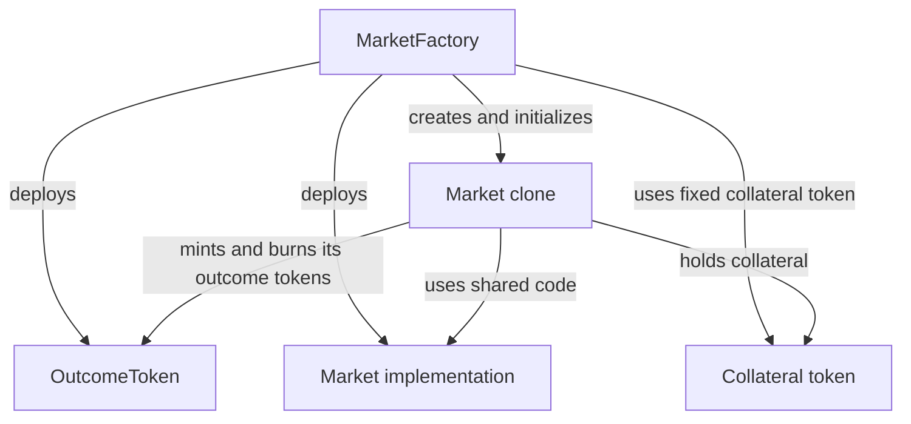

# Market creation and outcome tokens

`MarketFactory` creates binary prediction markets with YES and NO shares. Each market has its own question, closing time, arbitrator, and collateral-backed trading pool.

## Architecture

The factory deploys a shared `Market` implementation and an `OutcomeToken` ERC-1155 contract. Each new market is an EIP-1167 clone: it uses the shared implementation while keeping its own configuration, reserves, and collateral balance. Its implementation and configuration are fixed at creation.

All markets from a factory use the same six-decimal collateral token. Their YES and NO shares live in the shared outcome-token contract, which permits each market to mint and burn only its own token IDs.

## Creating a market

An admin chooses a future closing time, a nonzero arbitrator, and a nonempty market spec, then approves and supplies at least 10 whole collateral units as seed liquidity. Creation deploys, funds, and initializes the market in one transaction; any failure rolls back the entire operation.

For seed liquidity `L`, the market starts with `yesPool = noPool = L` and holds `L` shares of each outcome. Each YES/NO pair is backed by one collateral unit, and equal reserves give a 50/50 opening price. Other opening probabilities are currently unsupported. Subsequent trades adjust the reserves and mint or burn paired shares, as described in the [trading engine](trading-engine.md).

The spec describes the question and resolution rules. Its full text is emitted in `MarketCreated`, while the market stores a hash that lets clients verify the original text. The factory accepts any nonempty spec; the frontend and bot expect structured JSON. Their requirements are defined by the [frontend parser](../web/src/chain.ts) and [bot parser](../bot/sooth_bot/agent.py). A spec accepted on-chain is not necessarily usable by those clients or resolvable in practice.

## Design decisions and limitations

The arbitrator determines the outcome and may be the creator's own wallet. Choosing a wallet therefore means trusting its decisions. The [Chainlink resolver](chainlink-resolver.md) and [optimistic resolver](optimistic-resolver.md) provide alternative resolution mechanisms with their own trust assumptions.

Collateral backing depends on honest balance reporting and compatible ERC-20 transfers. Requiring six decimals alone does not establish those properties. Initialization checks for at least the seed amount rather than an exact balance: because clone addresses are predictable, an exact check would let someone block creation by sending collateral in advance. Extra collateral does not increase recorded reserves.

## References

- [Factory interface](../contracts/src/interfaces/IMarketFactory.sol) and [implementation](../contracts/src/MarketFactory.sol): creation parameters, validation, and events.
- [Market initialization](../contracts/src/Market.sol), [outcome-token permissions](../contracts/src/OutcomeToken.sol), and [token-ID derivation](../contracts/src/libraries/OutcomeTokenId.sol): contract mechanics.
- [Factory deployment](../contracts/script/DeployMarketFactory.s.sol) and [market creation script](../contracts/script/CreateMarket.s.sol): configuration and operation.
- [Factory tests](../contracts/test/MarketFactory.t.sol): creation, initialization, and token-isolation guarantees.
- [Market settlement and payouts](market-settlement.md): lifecycle and redemption after trading closes.
