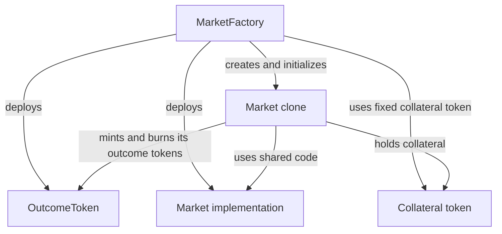

# Market creation and outcome tokens

Sooth creates binary markets through `MarketFactory`. Each market represents a question with YES and NO outcomes, a closing time, and a resolution rule. On-chain, it is an EIP-1167 clone contract with its own address, configuration, reserves, and collateral balance. Markets from the same factory share an `OutcomeToken` ERC-1155 contract and a `Market` implementation. Only accounts with `DEFAULT_ADMIN_ROLE` can create markets.

## Architecture



The factory deploys the outcome token and implementation in its constructor. Each clone represents one market and delegates calls to that code using the clone's own storage and address. The implementation embeds the factory, outcome-token, and collateral addresses as immutables shared by every clone; market-specific parameters are initialized in the clone's storage. The implementation disables initialization, and only the factory can initialize a clone, once.

## Creation flow

The creating admin must hold enough collateral and approve the factory to transfer the seed amount. A successful `createMarket` call performs these steps in one transaction:

1. Validate the inputs and hash the spec text.
2. Increment `marketCount` (IDs start at 1), deploy a clone, and record its address in `markets`.
3. Register the clone as the owner of its YES and NO token IDs in `OutcomeToken`.
4. Transfer the seed collateral directly from the caller to the clone.
5. Initialize the clone, check its reported collateral balance, set equal reserves, and mint equal YES and NO shares to the clone.
6. Emit `MarketCreated`, including the market address, creator, parameters, spec hash, and full spec text.

Registration precedes initialization because only the registered market can mint its token IDs. The collateral transfer precedes initialization because the clone checks its balance before minting. If any step reverts, the transaction rolls back. Separate transactions cannot intervene between cloning and initialization.

## Parameters and constraints

`createMarket` accepts an `IMarketFactory.CreateParams` struct:

| Field | Requirement |
|---|---|
| `arbitrator` | Nonzero address authorized to resolve the market. It can be a wallet or a resolver contract and can also be the creator. |
| `closeTime` | Unix timestamp strictly greater than the creation block's timestamp. |
| `initialYesProbabilityBps` | Must be `5_000`, giving a 50/50 opening price. |
| `spec` | Nonempty string. The factory hashes its bytes and emits the full text; it does not validate JSON or the meaning of the rules. |
| `initialLiquidity` | At least `MIN_LIQUIDITY` (`10e6` raw collateral units, or 10 whole units). |

The factory fixes one collateral token at deployment and requires it to report six decimals. This check does not establish that the token is USDC or that its transfer and balance behavior is suitable. The deployment configuration is responsible for choosing a compatible token. Every market from that factory uses it.

Collateral and outcome shares use raw six-decimal units: `1e6` is one whole collateral unit or one whole share. Each trade has a 1% fee, rounded up in raw units. An unresolved market becomes cancelled at `closeTime + 7 days`; closing and cancellation are derived from time without a state-changing transaction.

### Market spec

The factory stores `keccak256(bytes(spec))` in the market and emits the full text in `MarketCreated`. Consumers can hash the emitted text to verify it matches `specHash`; the contract cannot inspect the rules represented by the text.

The frontend expects JSON containing string fields `question` and `rules`, a supported `category`, and a `source` object with a string `label` and an HTTP(S) `url`. Its market-creation form also requires nonempty question, rules, and source label. The bot parses the question, rules, and source URL for optimistic proposals. A nonempty spec accepted by the factory can therefore be unusable to the frontend or bot.

## Outcome tokens and seed collateral

Each market has YES and NO ERC-1155 token IDs derived as:

```text
uint256(keccak256(abi.encode(marketId, outcome)))
```

`outcome` is the `IMarket.Outcome` enum: YES is 0 and NO is 1. The factory's shared `OutcomeToken` records the market responsible for each ID. Only the factory can register a market, and only the registered market can mint or burn its IDs; batch operations check every ID. Hash collisions are cryptographically improbable, not mathematically impossible.

For seed liquidity `L`, initialization records `yesPool = noPool = L` and mints `L` raw units of each outcome to the market. One YES and one NO together are backed by one raw collateral unit. The equal reserves give a 50/50 opening price. Trades change reserves and mint or burn paired shares; see the [trading engine](trading-engine.md) for its accounting and formulas.

## Design decisions and limitations

- **Collateral balance check:** Initialization requires the reported balance to be at least `L`, not exactly `L`. Clone addresses are predictable, so an exact check could let a third party block creation by sending collateral to the address first. Extra collateral does not increase recorded reserves. The check relies on the collateral token reporting balances honestly.
- **Arbitrator trust:** The creator may also be the arbitrator. A wallet arbitrator can choose the outcome; the [Chainlink resolver](chainlink-resolver.md) and [optimistic resolver](optimistic-resolver.md) impose their own resolution rules and operational requirements.
- **Fixed configuration:** Factory, collateral, outcome token, creator, arbitrator, close time, and spec hash are fixed for a market after initialization. Reserves, fees, and settlement state change over its lifecycle.
- **Spec integrity:** The hash commits to the exact bytes emitted at creation. It does not establish that the spec is well formed, fair, or resolvable.
- **Collateral compatibility:** Accounting assumes suitable ERC-20 transfer and balance behavior. Six reported decimals alone do not guarantee that transfers or payouts will succeed.

## Deployment and verification

Run Foundry commands from `contracts/`. `script/DeployMarketFactory.s.sol` accepts `ADMIN` (defaults to the broadcasting wallet) and `COLLATERAL`. If `COLLATERAL` is omitted, the script deploys `MockUSDC` only on Anvil, Base Sepolia, Ethereum Sepolia, or Arbitrum Sepolia; other chains require an explicit collateral address. The script rejects Foundry's default sender as admin.

`script/CreateMarket.s.sol` approves the factory and creates a market; its source documents the environment variables and optional Chainlink configuration. For the creation, clone, and outcome-token checks, run:

```sh
forge test --match-contract MarketFactoryTest
```

For subsequent market behavior, see the [trading engine](trading-engine.md), [market settlement and payouts](market-settlement.md), [Chainlink resolver](chainlink-resolver.md), and [optimistic resolver](optimistic-resolver.md) guides and their corresponding Foundry tests.
